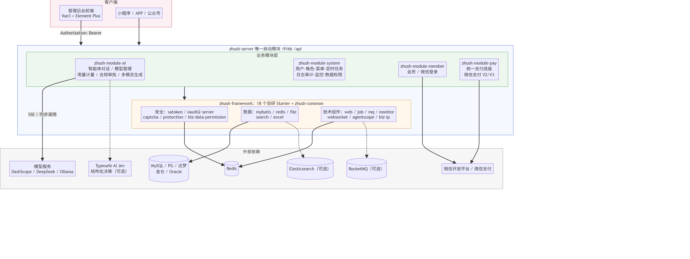
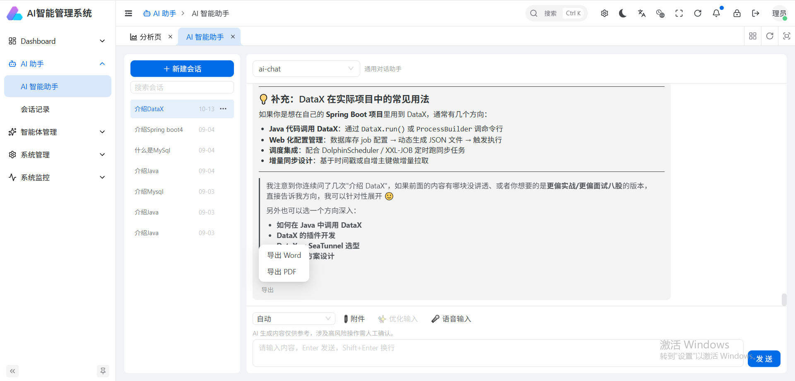
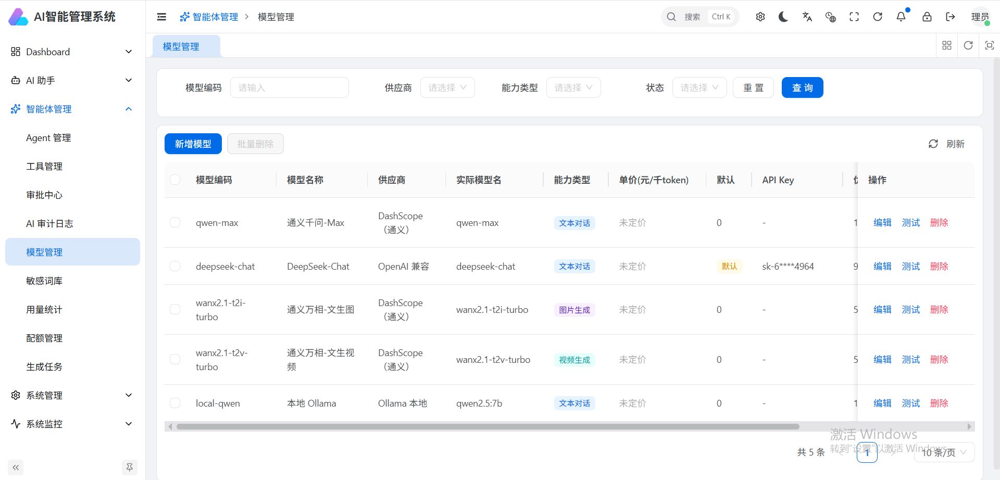
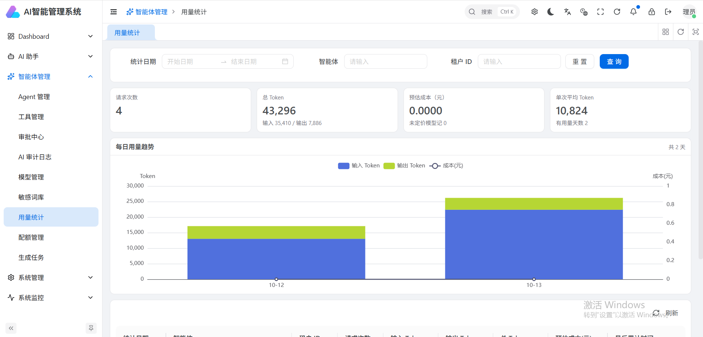
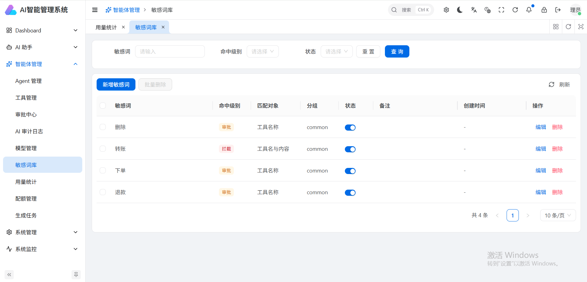
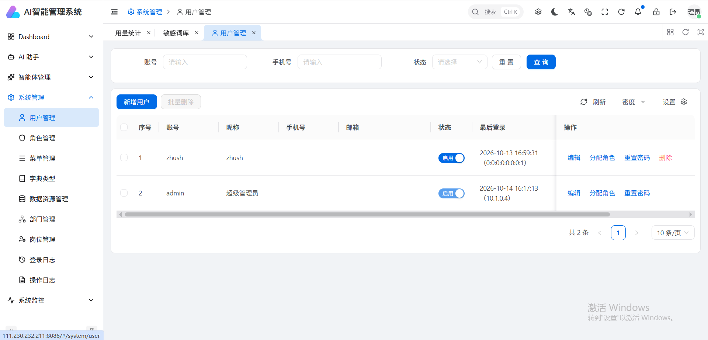
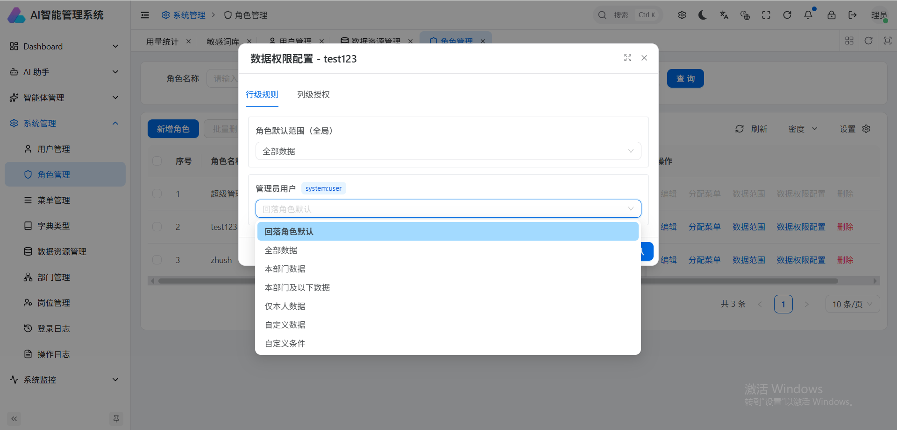
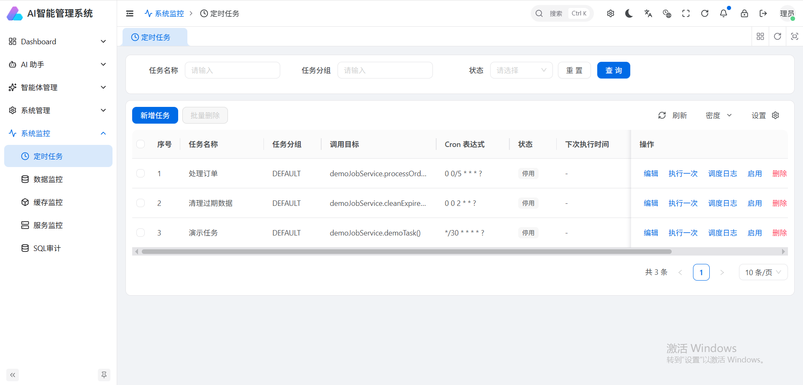
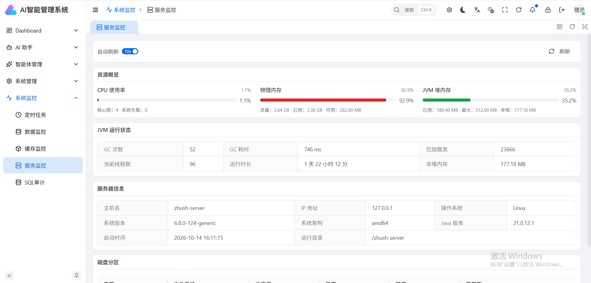

# zhush-ai-boot

## 简介

**zhush-ai-boot** 是基于 Spring Boot 4 / Java 21 构建的多模块 **AI 管理后台与智能体平台**后端工程。

系统以 AgentScope 智能体框架为核心，提供智能体对话（同步 + SSE 流式）、多供应商模型管理、Token 用量计量与成本核算、配额限流、敏感词合规与人工审批、图像/视频/文档生成等 AI 能力；同时内置一套完整的管理后台底座——用户、角色、菜单、部门、岗位、字典、公告、定时任务、日志审计、系统监控、数据权限（行级 + 字段级）、OAuth2、文件存储、行为验证码、统一支付（微信支付 V2/V3）与会员体系。

- 纯后端工程，接口文档基于 Knife4j 在线可查
- 所有可选能力（搜索、MQ、监控、支付、WebSocket 等）默认关闭，配置开关即插即用
- 敏感凭证全部经环境变量外置，支持 Jasypt 配置加密

## 架构图

依赖方向：`zhush-server → 业务模块 → framework starters → zhush-common`，版本由 `zhush-dependencies` BOM 统一收敛。

## 核心技术栈

| 领域 | 选型 | 版本 |
| --- | --- | --- |
| 语言 / 运行时 | Java | 21 |
| 应用框架 | Spring Boot / Spring Framework | 4.1.0 |
| 智能体框架 | AgentScope（core / harness / 模型扩展 / redis / Jev） | 2.0.4 |
| 模型 SDK | 阿里云 DashScope（qwen 系列、图像/视频生成） | 2.22.9 |
| ORM | MyBatis-Flex | 1.11.8 |
| 数据库 | MySQL（默认），适配 PostgreSQL / 达梦 / 人大金仓 / Oracle | — |
| 连接池 | Druid | 1.2.28 |
| 缓存 | Redis（Redisson） | 4.6.1 |
| 认证鉴权 | Sa-Token + OAuth2 模块 | 1.46.0 |
| 定时任务 | Quartz（JDBC 持久化） | — |
| 消息队列 | RocketMQ（可选） | 5.5.0 |
| 全文搜索 | Elasticsearch（可选） | — |
| 文档解析 / 生成 | Apache Tika / POI（Word）/ OpenPDF（PDF） | 3.3.1 / 5.5.1 / 2.0.3 |
| 微信生态 | WxJava（公众号 / 小程序 / 企业微信 / 支付） | 4.8.0 |
| 接口文档 | Knife4j + SpringDoc OpenAPI | 5.2.4 / 3.0.3 |
| 监控 | SkyWalking / Spring Boot Admin（可选） | 9.6.0 / 4.1.2 |
| 行为验证码 | tianai-captcha | 1.5.5 |
| 配置加密 | Jasypt | 4.0.4 |
| 对象映射 | MapStruct Plus + Lombok | 1.5.1 / 1.18.46 |

## 工程结构

```
zhush-boot4-parent
├── zhush-dependencies          # BOM：全局依赖版本统一管理
├── zhush-framework             # 框架层聚合
│   ├── zhush-common            # 公共工具、通用模型、基础抽象
│   └── zhush-spring-boot-starter-*
│       ├── web / mybatis / redis / satoken / oauth2-server
│       ├── biz-data-permission / biz-ip / captcha / excel / file
│       ├── job / monitor / mq / protection / search / websocket
│       └── agentscope / test
├── zhush-module-system         # 系统管理模块（管理后台底座）
├── zhush-module-member         # 会员模块（C 端用户、微信登录）
├── zhush-module-pay            # 统一支付底座（微信支付 V2/V3）
├── zhush-module-ai             # AI 智能体模块（核心业务）
├── zhush-server                # 唯一可执行启动模块，聚合打包
├── sql                         # 数据库增量脚本
└── docs                        # 专题文档（数据权限系列）
```

业务模块内统一分层：`controller`（`admin` / `app` / `open` 分端）→ `service` → `mapper` → `entity`，配合 `param`（入参）/ `query`（查询）/ `vo`（出参）。

版本管理：`flatten-maven-plugin` + `${revision}` 占位符（当前 `1.0.0`）；依赖版本只允许出现在 BOM 中。

## 开源协议

本项目基于 [Apache License 2.0](LICENSE) 开源。允许商业使用、修改与分发，需保留版权声明与协议副本；不得使用本项目商标，且不提供任何担保。

## 项目外包

团队提供基于本系统的定制开发与外包服务，涵盖：

- AI 智能体平台私有化部署与定制（模型接入、知识库、工作流编排）
- 管理后台二次开发（业务模块、审批流、数据权限）
- 微信小程序 / 公众号 / APP 前后端一体交付
- 支付、OAuth2、第三方系统集成

项目可以是数据工厂、企业内部管理系统、门户系统、微信公众号、小程序（微信/抖音/支付宝）、AI智能化系统等等。
如有合作意向，请通过以下方式联系：

- 邮箱：`andycabbage@163.com`
- 微信：`vue950120`

## 前端项目

本仓库为纯后端工程，配套管理后台前端项目另行维护：

- **zhush-admin-ui-ai**：基于  Vue Vben Admin 5.7 的管理后台，对接本工程 `/api/admin/**` 接口
- 前端仓库地址：`https://gitee.com/primay/zhush-vue3-admin-ui-ai.git`

启动后端后，可直接访问 Knife4j 接口文档（`http://localhost:9166/api/doc.html`）进行联调。

## 系统基础功能

### AI 智能体（zhush-module-ai）

| 功能 | 说明 |
| --- | --- |
| 智能体对话 | 同步 + SSE 流式输出，多会话管理、会话归属校验 |
| 智能体管理 | 智能体定义、工具注册与调用、执行日志 |
| 模型管理 | 多供应商（DashScope / OpenAI 兼容 / Ollama），API Key 加密存储，库表动态配置 + 广播刷新 |
| 用量计量 | Token 真实计量与日聚合、成本估算、配额规则与限流 |
| 合规安全 | 敏感词库、合规守卫、危险操作人工审批流 |
| 多模态生成 | 图像 / 视频生成任务（异步提交 + 轮询）、Word / PDF 文档产物生成、Tika 文档解析 |
| Jev 决策（可选） | 意图路由与提示词润色，失败自动降级不阻断主流程 |
| 审计 | 对话与工具执行审计日志、Jev 决策记录采样落库 |

### 系统管理（zhush-module-system）

- 管理员、角色、菜单、部门、岗位、字典（类型/数据）、通知公告
- 登录日志、操作日志（Excel 导出）、OpenAPI 调用日志、SQL 审计日志
- 定时任务管理与执行日志（Quartz）
- 文件管理（本地 / 阿里云 OSS / 七牛 / 华为 OBS，改配置即切换）
- 系统监控：Druid 统计（授权接口输出）、服务状态、Redis 缓存监控
- 数据权限：行级 SQL 过滤（`@DataPermission`）+ 字段级置空/脱敏（`@FieldPermission`），支持页面化配置
- OAuth2 客户端管理、社交登录、开放接口（`/open/**`）、企业微信 / 开放平台集成

### 会员与支付

- **会员模块**：账号登录、小程序 code 登录、会员管理（管理端），公众号 / 小程序能力接入
- **支付底座**：协议无关抽象层 + 微信 V3 商家转账（有回调、可撤销）、V2 企业付款到银行卡（定时查单收敛）、多商户路由预留、出款限额；凭证全部环境变量外置，未启用零 Bean 装配

### 安全设计

- 双域鉴权：`/api/admin/**` 管理端权限注解校验，`/api/member/**` 会员端登录态校验
- Token：`Authorization: Bearer` 承载、不读写 Cookie（防 CSRF）、2 小时有效 + refresh-token 无感续期、多端并发 / 同端互踢
- 接口幂等、行为验证码（滑块/旋转/拼图）、SM4 参数加解密、CORS 可收敛

## 演示图

| | |
| --- | --- |
|  |  |
|  |  |
|  |  |
|  |  |

## 快速开始

```bash
# 环境：JDK 21+ / Maven 3.8+ / MySQL 8+ / Redis 6+
mvn clean install -DskipTests
mvn -pl zhush-server spring-boot:run
```

启动后访问 `http://localhost:9166/api/doc.html`。模型 API Key 通过环境变量注入（`DASHSCOPE_API_KEY`、`DEEPSEEK_API_KEY`），本地可用 Ollama 免 Key 体验。详见 [application-dev.yaml](zhush-server/src/main/resources/application-dev.yaml) 中的配置注释。

## 致谢

感谢 [@芋道源码](https://gitee.com/zhijiantianya) 开源系统，本系统架构思路参考学习芋道源码单体系统的三层架构进行构建。

---

如果本项目对你有帮助，欢迎点亮 ⭐ Star 支持！
